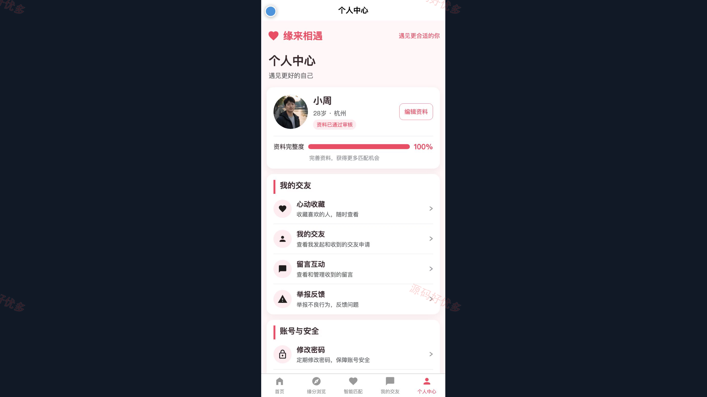
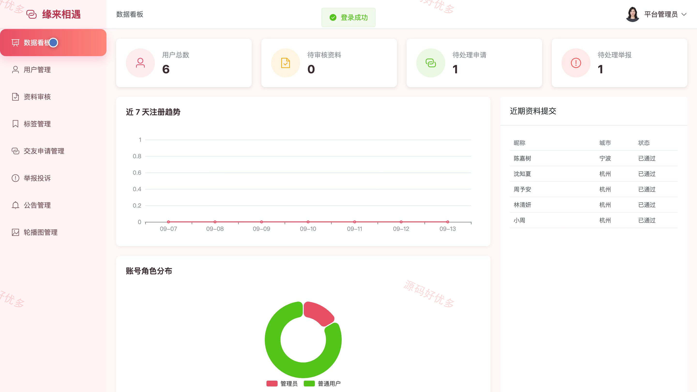
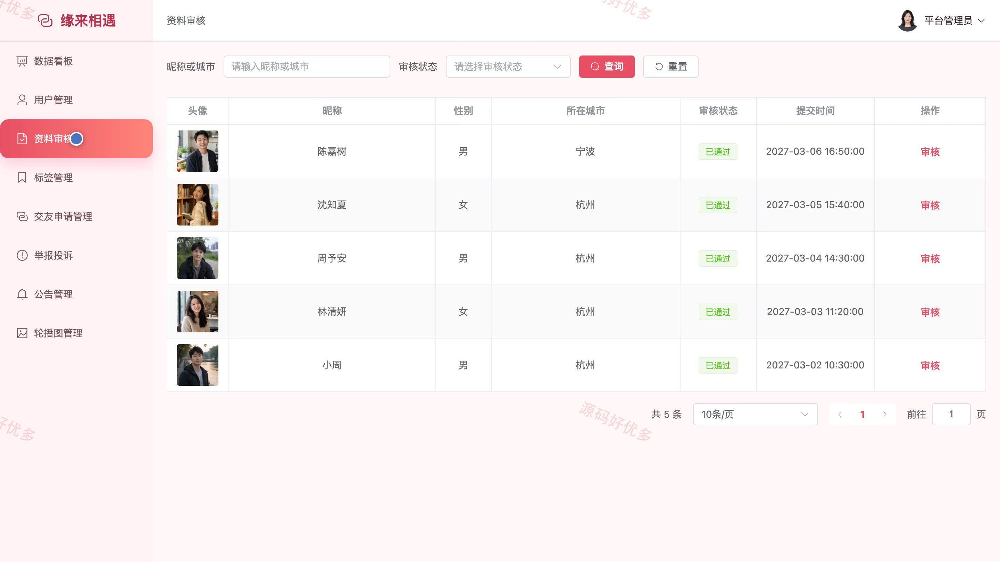
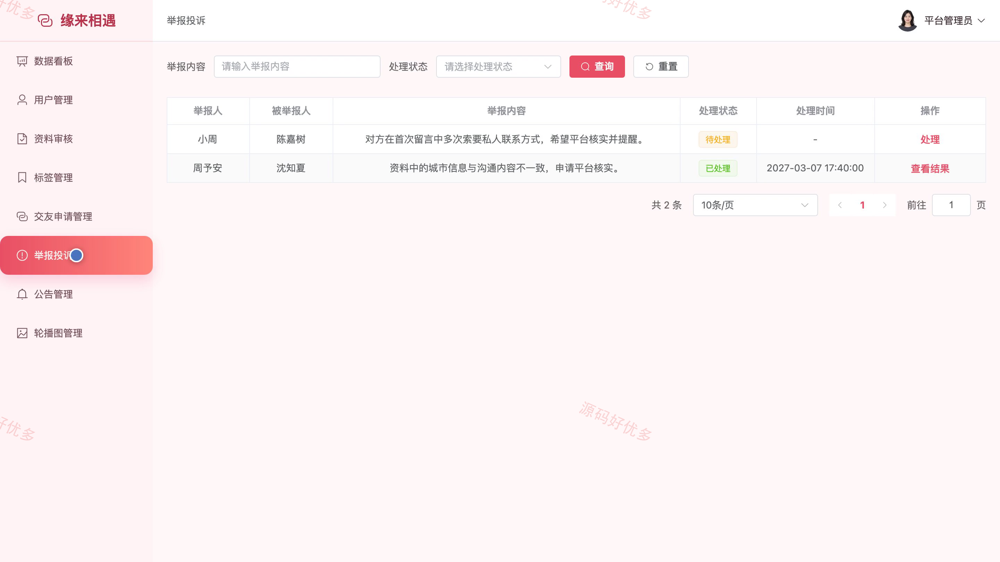

## 源码问题查看主页咨询

### 一、关键词
相亲交友、智能匹配、兴趣推荐、交友申请、留言互动

### 二、作品包含
源码+数据库+万字设计文档+PPT+全套环境和工具资源+本地部署教程

### 三、项目技术
前端技术： Html、Css、Js、Vue3.4、Element-Plus、uniapp
后端技术：Java、SpringBoot3.2.0、MyBatis-Plus

### 四、运行环境要求
开发工具：IDEA/eclipse + VSCODE + HBuilder X + 微信开发者工具

数据库：MySQL5.7+（共11张表）

数据库管理工具：Navicat10以上版本

环境配置软件： JDK17 + Maven3.6

前端Nodejs：20

浏览器：谷歌浏览器

### 五、项目介绍
项目编号：bs062B

相亲交友与智能匹配小程序面向认真交友的用户与平台管理员，提供资料完善、择偶条件设置、缘分浏览、智能匹配、收藏、交友申请、留言互动和举报处理，并支持后台审核资料以及维护标签、公告与轮播内容。

角色：用户、管理员

用户功能：注册登录与账户安全、个人资料与择偶条件、缘分浏览与智能匹配、心动收藏、交友申请处理、留言互动、举报反馈。

管理员功能：数据统计、用户管理、资料审核、标签管理、交友申请管理、举报投诉处理、公告管理、轮播图管理。

### 六、运行截图

